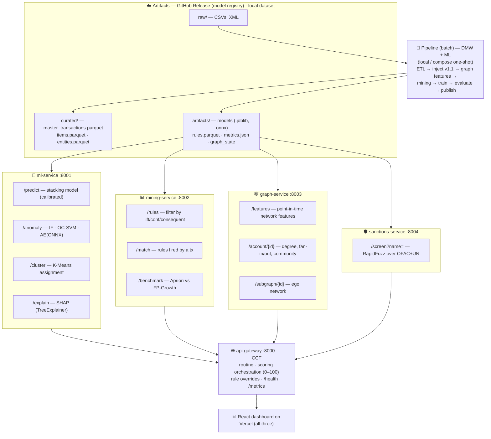
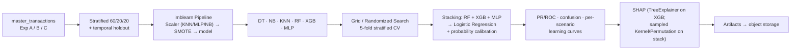
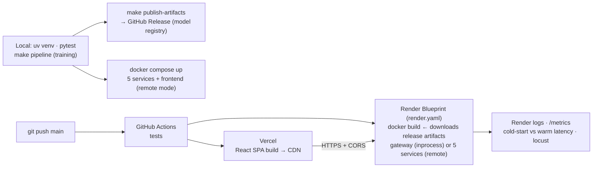

# FinSight AI — Final Integrated Project Plan (v2)
## Cloud-Based Financial Intelligence, Pattern Mining & Machine Learning Platform

**Three Subjects. One Project. One Dataset.**

> This single project is submitted across three subjects simultaneously:
> - 🤖 **ML** — Machine Learning
> - 📊 **DMW** — Data Mining & Wrangling
> - ☁️ **CCT** — Cloud Computing & Technology
>
> Each professor evaluates the same working system through their own subject's lens.

> [!NOTE]
> **v2 (2026-11-21)** — revised after a full dataset audit. See **Section 0** for what was found and what changed. Everything below reflects the revised plan.

---

## 0. Plan Review — Audit Findings & Revisions

### 0.1 What the audit confirmed (good news)
- All 7 India files load cleanly: **0 nulls** (except `alert_id`, which is null by design for non-alerts), **0 duplicates**, **100% referential integrity** (accounts, customers, devices).
- `graph_edges.csv` is a 1:1 mirror of `transactions_features.csv` (same order, amounts, senders).
- `account_balance_after = before − amount` holds for 100% of rows.
- The problem is **not trivially separable**, so the ML experiments are meaningful. 5-fold F1 for `is_fraud`: Exp A (raw transaction) RF ≈ 0.72, Exp B (+behavioural) RF ≈ 0.85. BORDERLINE rows (labelled `is_fraud=0` but fraud-like features) are the main source of confusion, which makes for a good analysis story.

### 0.2 Problems found → fixes

| # | Finding (evidence) | Impact on v1 plan | Fix in v2 |
|---|---|---|---|
| 1 | **No network structure in the data.** Fan-in/fan-out/degree AUC = 0.50–0.52; pass-through timing AUC = 0.50; 1h/24h velocity AUC = 0.50; median shared-device accounts = 1 in every scenario. Fraud is spread over ~900 random sender accounts. | Exp C, RQ3, Graph service, Network Explorer and the "fan-in = 8" demo would all be empty. | **Phase 1b: seeded graph-structure injection → dataset v1.1** (Section 6.3). v1.0 stays untouched. |
| 2 | **`rapid_forward_delta_sec` is a label proxy**: non-zero *only* for S6/S7 (100% fraud) and inconsistent with the actual transaction timeline. | A model using it would "detect" 350 frauds with perfect recall, which is leakage. | Excluded. Rapid-forward is **recomputed from real timestamps** in v1.1. |
| 3 | **More leakage columns**: `is_flagged_alert` and `alert_id` = 1 exactly for FRAUDULENT ∪ BORDERLINE; `scenario_id` also appears in `graph_edges.csv`. | Leakage risk. | Added to the leakage blacklist (Section 18), enforced in code by `feature_sets.py`. |
| 4 | **`beneficiaries.csv` cannot be joined per transaction**: only 8 / 10,000 (sender, receiver) pairs exist in it; 0 receiver VPAs match. | The planned 7-file merge would add almost no information. | Aggregate **per sender account** instead (beneficiary count, # added in last 7 days, min prior_tx_count). |
| 5 | **Redundant / constant columns**: `transaction_type` ≡ `channel` (UPI=P2P, NEFT=C2B, RTGS=B2B); `status` is always SUCCESS; IP is effectively unique per tx. | Wasted features; inflated one-hot dimensions. | Drop `transaction_type` and `status` from features (documented in the Data Quality Report as findings). |
| 6 | **Dead discretisation items**: `NEW_ACCOUNT` matches 0 rows, `IMMEDIATE_REPEAT` matches 2; `ODD_HOUR` and `RAPID_BURST` (as given by `tx_frequency_24h`) carry no signal. | Apriori would mine noise. | Discretisation table rebuilt from the audit counts (Section 6.4). |
| 7 | **Isolation Forest "trained on PaySim, applied to India"** is impossible: completely different feature spaces (PaySim has no device, location or beneficiary columns). Also, `contamination=0.135` contradicts training on legitimate-only data. | Invalid experiment. | Anomaly detectors are trained on **India legitimate training rows**, with the threshold set by percentile. PaySim becomes its own **big-data track** (Polars + its own IF evaluated against PaySim `isFraud`). |
| 8 | **IEEE-CIS "pre-training"** is infeasible (anonymous V1–V339, no shared schema). | Invalid. | IEEE-CIS becomes the **DMW data-quality showcase**: the India data has no nulls, while IEEE-CIS has heavy missingness and a real 2-table join (transaction ⋈ identity). |
| 9 | **Sanctions hits will be ~0**: the synthetic Indian customer names won't match OFAC/UN lists. | `sanctions_hit` would be a constant, useless feature. | Sanctions is a **screening service + rule override**, not a model feature. A DMW mini-experiment measures fuzzy-threshold false-positive rates over all 1,200 customers. |
| 10 | **Phase ordering bug**: graph features (old Phase 7) are needed by Exp C (old Phase 4). | Exp C couldn't be run in phase order. | Graph features move to **Phase 3**, before mining and ML. |
| 11 | **Inconsistent ports / counts** (diagram vs table vs endpoint list; "8 endpoints" vs 7 shown; K = 2..8 vs 3..8). | Confusing. | One authoritative service table (Section 8.1). |
| 12 | **9 containers**: ETL as a long-running server and a separate scoring hop add latency and cost without adding concepts. | Heavy on Cloud Run; harder to demo. | **5 services + dashboard + batch job + object storage** (Section 8.1). |
| 13 | **Keras/TensorFlow** adds ~2 GB to images. | Slow builds and cold starts. | Autoencoder trained in **PyTorch**, exported to **ONNX**, served with `onnxruntime` (~50 MB). Framework-agnostic serving is itself a good CCT talking point. |
| 14 | **SMOTE before CV** would leak synthetic neighbours across folds. | Optimistic CV scores. | SMOTE lives **inside an imblearn `Pipeline`**, so it's re-fit per fold. SMOTE is also compared against `class_weight` as an experiment. |
| 16 | **Deployment target changed** by the team: must run on **Vercel + Render** (2026-11-21). | GCP Cloud Run plan obsolete; Streamlit can't run on Vercel; Render free has no private networking. | React SPA on Vercel + FastAPI on Render; inprocess/remote service modes; artifacts via GitHub Releases (§8.0, D-022–D-024). |
| 15 | **Docker is not installed** on the dev machine. | Blocks Phase 8. | Install Docker Engine + Compose plugin before Phase 8 (the user needs sudo). |

---

## 1. The One-Line Identity

> **FinSight AI** is a cloud-deployed financial transaction intelligence platform that applies the full KDD pipeline and association-rule mining (DMW), trains and optimises a suite of machine learning models including clustering, anomaly detection, ensemble classifiers and neural networks (ML), and delivers everything through cloud-native containerised microservices with a REST API and interactive analytics dashboard (CCT) — all on a synthetic Indian payment ecosystem of 10,000 transactions.

---

## 2. The Three-Subject Division — Clean Boundaries

```mermaid
flowchart TD
    Data["🗄️ Same Dataset\n10K India Transactions (v1.1)\n+ IEEE-CIS · PaySim · OFAC · UN Sanctions"]

    Data --> DMW & ML & CCT

    subgraph DMW["📊 DATA MINING & WRANGLING"]
        direction TB
        DW1["KDD Pipeline\n7-step process"]
        DW2["Multi-source Wrangling\n7 CSVs + XML → Master Dataset"]
        DW3["Data Quality Pipeline\nIndia + IEEE-CIS (missingness)"]
        DW3b["Graph-structure Injection\nv1.0 → v1.1 (seeded, documented)"]
        DW4["Association Rule Mining\nApriori vs FP-Growth (+ closed/maximal)"]
        DW5["Discretisation & Item Transformation"]
        DW6["Pattern Evaluation\nSupport · Confidence · Lift"]
    end

    subgraph ML["🤖 MACHINE LEARNING"]
        direction TB
        ML1["Supervised Classification\nDT · NB · KNN · RF · XGBoost · MLP"]
        ML2["Unsupervised\nK-Means · DBSCAN"]
        ML3["Anomaly Detection\nIsolation Forest · OC-SVM · Autoencoder"]
        ML5["Tuning · CV · Learning Curves"]
        ML6["Stacking Ensemble + Calibration"]
        ML7["Explainability — SHAP"]
    end

    subgraph CCT["☁️ CLOUD COMPUTING & TECHNOLOGY"]
        direction TB
        CC1["Artifact Registry & Storage\nGitHub Releases · fsspec (S3-compatible)"]
        CC2["Containerisation\n5 services + dashboard + batch job"]
        CC3["Microservices + API Gateway\nFastAPI"]
        CC5["Render (FastAPI containers)\n+ Vercel (React SPA on CDN)"]
        CC6["Scaling · Health · Metrics · IaC"]
    end

    DMW & ML & CCT --> Platform["FinSight AI Platform\n🖥️ React Dashboard (Vercel)\n🌐 REST API (Render)"]
```



---

## 3. The Three-Lens View (For Your Professors)

| Dimension | 📊 DMW | 🤖 ML | ☁️ CCT |
|-----------|--------|-------|--------|
| **Core Question** | What patterns exist in the data? | Which model best identifies risk, and how can it be optimised? | How do we deploy this as a scalable cloud service? |
| **Primary Method** | KDD + Association Rule Mining | Model training, tuning, evaluation, ensemble | Docker microservices + REST API + cloud deploy |
| **Dataset Role** | Raw research corpus for KDD | Feature matrix for supervised + unsupervised learning | Cloud-stored data and artifacts loaded at startup |
| **Core Output** | Association rules, data quality report, v1.1 dataset | Trained models, comparison table, learning curves | Deployed API returning JSON risk reports |
| **Dashboard Role** | Pattern Mining Lab, Data Quality page | ML Lab, Clustering, Risk Scorer | Cloud-served frontend, API consumer, metrics |
| **Unique Deliverable** | Apriori vs FP-Growth experiment; leakage audit | Exp A/B/C ablation + Anomaly + SHAP | Vercel + Render deployment, docker-compose microservices |

---

## 4. Dataset Inventory

| # | Dataset | Size | DMW Use | ML Use | CCT Use |
|---|---------|------|---------|--------|---------|
| 1 | **Custom India Synthetic v1.0** (7 files) | 10K tx | Primary KDD corpus; leakage audit | Baseline for Exp C (v1.0 vs v1.1 sanity check) | Raw zone in bucket |
| 1b | **Custom India Synthetic v1.1** (derived) | 10K tx | Output of graph-structure injection | **Primary training data** | Curated zone; API input |
| 2 | **IEEE-CIS Fraud** | 590K + 144K rows, 434 cols | **Data-quality showcase**: 2-table join, missingness profiling, imputation comparison | Optional: real-data generalisation check (XGBoost) | Large-file storage demo |
| 3 | **PaySim Mobile Money** | 6.36M rows | **Big-data wrangling** with Polars (lazy, streaming) | Isolation Forest on PaySim's own features, evaluated vs `isFraud` | Scalability demo (Cloud Run Job) |
| 4 | **OFAC SDN** | 19,320 entities (headerless CSV, `-0-` = null) | Parse + normalise names/aliases | — (not a feature) | Sanctions microservice |
| 5 | **UN Consolidated Sanctions** | XML (individuals + entities + aliases) | XML → tabular → unify with OFAC | — | Sanctions microservice |

> **Regulatory PDFs**: RBI Master Directions on Fraud Risk Management + FATF Recommendations 2026 provide compliance framing (risk tiers, sanctions screening, structuring) for the report.

> **Synthetic-data disclaimer**: all results on India v1.0/v1.1 describe the generator's behaviour, not real-world fraud. v1.1 injection rules are published alongside the results.

---

## 5. Full System Architecture



**Scoring (inside the gateway):**
`risk = 100 × (w1·P(fraud)_stacking + w2·anomaly_pct + w3·graph_risk)`. Weights are chosen on the validation set (grid over the simplex, maximising PR-AUC). Overrides: sanctions match ≥ 90 → **CRITICAL**; PEP customer → floor at **MEDIUM**; structuring rule fired → +10. Tiers: LOW < 30 ≤ MEDIUM < 60 ≤ HIGH < 85 ≤ CRITICAL. Tier cut-offs are chosen from validation precision/recall.

---

## 6. Subject 1 — Data Mining & Wrangling (DMW)

> [!IMPORTANT]
> DMW owns the **KDD process**, **data wrangling + quality**, the **v1.1 injection step**, and **association rule mining**. DT/NB/KNN appear here as pattern-discovery classifiers; ML optimises and extends them.

### 6.1 KDD Pipeline — 7 Steps (Explicitly Labelled)

| KDD Step | FinSight AI Implementation |
|----------|--------------------------|
| **1. Data Selection** | 7 India files; PaySim + IEEE-CIS as auxiliary corpora; targets `is_fraud` (primary), `risk_label` (secondary) |
| **2. Data Cleaning** | Type correction (`timestamp → datetime[Asia/Kolkata]`), constant/redundant column removal, OFAC `-0-` sentinel → null, name normalisation; IEEE-CIS missingness handling |
| **3. Data Integration** | 7-file merge → `master_transactions.parquet`; OFAC CSV + UN XML → `entities.parquet` |
| **4. Data Transformation** | v1.1 graph injection; point-in-time graph features; discretisation for mining; encoding + scaling for ML |
| **5. Data Mining** | Apriori + FP-Growth (+ FP-Max for maximal itemsets); base classifiers |
| **6. Pattern Evaluation** | Rules filtered at Lift > 1.5, Confidence > 0.6; classifiers by F1 / PR-AUC / ROC-AUC |
| **7. Knowledge Presentation** | Dashboard: Data Quality, Pattern Mining Lab, Network Explorer |

### 6.2 Data Wrangling — The 7-File Merge (revised)

```
transactions_features.csv      ← core features (drop: transaction_type≡channel, status=constant)
  + transactions_targets.csv   ← labels ONLY (is_fraud, risk_label, scenario_id kept for evaluation)
  + accounts.csv               ← on sender_account_id: account_age_days, 30d hist stats, balance
  + customers.csv              ← on sender_customer_id: kyc_status, pep_flag, declared_income
  + devices.csv                ← on device_id: device_type, is_registered, associated_accounts_count
  + beneficiaries.csv          ← AGGREGATED per sender account (pair-join matches only 8 rows):
                                  bene_count, bene_added_7d, min_prior_tx_count
  + graph_edges.csv            ← rebuilt from v1.1; network features computed point-in-time
  ──────────────────────────────────────────────────────
  = master_transactions.parquet (+ .csv export)
```

**Data Quality Report deliverable** (India v1.0, India v1.1, IEEE-CIS):

| Metric | Calculation |
|--------|-------------|
| Completeness | 1 − (nulls / total cells), per column and overall |
| Duplicate Rate | duplicate rows / total rows (exact + on business key) |
| Valid Timestamps | parsed timestamps / total |
| Referential Integrity | FK matches / FK rows, per relationship |
| Redundancy | constant columns, perfectly-correlated pairs (e.g. channel ≡ type) |
| Leakage Scan | columns with single-feature AUC > 0.95 or deterministic mapping to the label |
| Label Balance | LEGITIMATE 82% / FRAUDULENT 13.5% / BORDERLINE 4.5% |

### 6.3 Graph-Structure Injection (v1.0 → v1.1) — NEW

**Why:** the generator labelled network-fraud scenarios but never wired them into the graph (Finding #1).
**Rule:** only the transactions of the listed scenarios are modified, plus a **legitimate decoy layer** and a **camouflage** step, so the graph signal is realistic rather than a perfect giveaway. Seeded (`seed=42`), deterministic, with a per-row change log.

| Scenario | Rows | Injected structure |
|---|---|---|
| S9 Fraud ring hub | 200 | ~10 rings; each ring's senders (≈20) pay **one hub account** within a 48h window |
| S8 Mule pass-through | 200 | 100 pairs: X→M, then **M→Y 2–30 min later at 90–98% of the amount** |
| S7 Layering | 200 | 50 chains A→B→C→D→E; each hop 5–60 min later, amount decays 2–5% |
| S3 Rapid burst | 150 | 30 senders × 5 tx within 10 min |
| S6 Structuring | 150 | 30 senders × 5 tx of **₹45,000–49,999** within 24h |
| S11 Shared device/IP | 150 | 15 devices × ~10 distinct sender accounts; shared IP per device |
| **Legit decoys** | ~5% of S1 | Merchant hubs (high fan-in C2B), family shared devices, occasional benign quick forwards, salary-day bursts |
| **Camouflage** | 50% of FRAUDULENT rows in S3/S6/S7/S8/S9/S11 (471) | `is_new_device`, `is_new_beneficiary`, `time_since_beneficiary_added_min`, `distance_from_home_km` copied from random legitimate rows |

**Why camouflage (decided 2026-11-21):** after rewiring alone, behavioural features still caught ~99% of the network scenarios (the generator gave them obvious per-transaction fingerprints), so network features had no room to help (PR-AUC 0.924 → 0.933). Real organised fraud looks normal one transaction at a time, so half of it is camouflaged: "opportunistic" fraud is caught by behaviour, "organised" fraud only by the graph.

**Phase 1b result** (5-fold RF, `class_weight=balanced`, F1 on `is_fraud`; `reports/phase1b_validation.txt`):

| Dataset | Exp A | Exp B | Exp C |
|---|---|---|---|
| v1.0 (control — no structure) | 0.724 | 0.874 | 0.872 |
| v1.1 (structure + 50% camouflage) | 0.754 | 0.810 | **0.839** |

Max single-feature AUC among network features on v1.1 = 0.64, so there is no giveaway.

After rewiring, every derived column is **recomputed from the new timeline**: `day_of_month`, `hour_of_day`, `day_of_week`, `tx_frequency_24h`, `time_since_last_tx_sec`, and `graph_edges.csv` (`rapid_forward_delta_sec` recomputed from real in→out pairs). Output: `dataset/processed/custom_india_v1_1/` with `dataset_metadata.json` + `injection_log.csv`.
**Validation:** re-run the audit. Network-feature AUC should rise for S3/S6/S7/S8/S9/S11 while staying ≈ 0.5 for S2/S4/S5/S10/S12, and the decoys should keep single-feature AUC < 0.95.

### 6.4 Discretisation for Association Mining (revised from audit counts)

| Item | Rule | Audit evidence (Legit / Borderline / Fraud) |
|---|---|---|
| `HIGH_AMOUNT_SPIKE` | amount_ratio_vs_30d_avg > 5 | 1497 / 291 / 945 |
| `MODERATE_AMOUNT_SPIKE` | 2 < ratio ≤ 5 | 715 / 66 / 179 |
| `HIGH_VALUE` | amount ≥ ₹50,000 | 1035 / 213 / 781 |
| `NEAR_THRESHOLD` | ₹45,000 ≤ amount < ₹50,000 | 58 / 28 / 136 |
| `NEW_DEVICE` | is_new_device = 1 | 1253 / 252 / 989 |
| `NEW_BENEFICIARY` | is_new_beneficiary = 1 | 1610 / 180 / 980 |
| `RECENT_BENEFICIARY` | beneficiary added < 24h ago | 0 / 216 / 1161 |
| `FAR_FROM_HOME` | distance > 100 km | 0 / 197 / 550 |
| `EXTREME_LOCATION` | distance > 500 km | 0 / 149 / 101 |
| `ODD_HOUR` | hour < 6 or > 22 | 803 / 55 / 143 *(kept: shows a non-pattern)* |
| `CH_UPI` / `CH_NEFT` / `CH_RTGS` | channel | context items |
| `PEP_CUSTOMER`, `KYC_NOT_VERIFIED` | customer attributes | rare context items |
| `PASS_THROUGH`, `HUB_RECEIVER`, `BURST_SENDER`, `SHARED_DEVICE` | from v1.1 graph features | NEW (post-injection) |
| `FRAUDULENT` / `BORDERLINE` | risk_label | *consequent only* |

Dropped: `NEW_ACCOUNT` (0 rows), `IMMEDIATE_REPEAT` (2 rows), `RAPID_BURST` from `tx_frequency_24h` (no signal; replaced by the computed `BURST_SENDER`).

> Note: `RECENT_BENEFICIARY` and `FAR_FROM_HOME` never occur on legitimate transactions — a **synthetic-generator artifact** the report should call out explicitly (high-confidence rules are partly by construction).

### 6.5 Association Rule Mining Experiment

> **Results (Phase 4, 2026-11-21):** see `notebooks/03_association_mining.ipynb` and `reports/mining_summary.json`. v1.1: 49 productive rules (16 with network items) vs v1.0: 34 (0 network). Apriori = FP-Growth itemsets; peak memory 1,317 MB vs 78.5 MB at 49 items / s = 0.002. Top rule {PASS_THROUGH} → FRAUDULENT (conf 99%, lift 7.4).


- **Full dataset:** min_support = 0.01, min_confidence = 0.5 → filter Lift > 1.5, Confidence > 0.6, consequent ∈ {FRAUDULENT, BORDERLINE}
- **Fraud-only subset:** min_support = 0.05 → which behaviours co-occur *within* fraud?
- **Apriori vs FP-Growth benchmark:** runtime and peak memory (`tracemalloc`) across min_support ∈ {0.005, 0.01, 0.02, 0.05}; itemset counts must match exactly (a correctness check)
- **Closed & maximal itemsets:** FP-Max (maximal) + closed-itemset filter → compression ratio vs all frequent itemsets
- **Scale track:** FP-Growth on PaySim (discretised, 6.36M rows) to show where Apriori breaks down

---

## 7. Subject 2 — Machine Learning (ML)

### 7.1 Targets, Splits, Leakage Control
- **Primary target:** `is_fraud` (binary). BORDERLINE = 0 but analysed separately (where do models put them?).
- **Secondary (extension):** 3-class `risk_label` with the best model.
- **Split:** stratified 60/20/20 on `risk_label` (keeps borderline proportions) + **temporal robustness check** (train Aug 1–23 → test Aug 24–30).
- **Imbalance:** SMOTE inside an `imblearn.Pipeline` (re-fit per CV fold) vs `class_weight='balanced'` — compared as an experiment.
- **Metrics:** PR-AUC (primary, given the imbalance), F1, ROC-AUC, precision/recall at the chosen threshold, per-scenario recall. The decision threshold is tuned on validation, never on test.

### 7.2 ML Workflow



### 7.3 Module 1 — Supervised Classification: 3 Feature Sets × 6 Classifiers

| Experiment | Features |
|---|---|
| **A — Transaction** | amount_inr (log), channel, hour_of_day, day_of_week, account_balance_before, account_age_days, 30d hist stats |
| **B — + Behavioural** | A + is_new_device, is_new_beneficiary, time_since_beneficiary_added_min, amount_ratio_vs_30d_avg, distance_from_home_km, tx_frequency_24h, time_since_last_tx_sec, device registered/associated accounts, beneficiary aggregates, kyc/pep |
| **C — + Network** | B + point-in-time graph features (Section 7.8) |

Run on **v1.1** (primary). Exp C is also run on **v1.0** as a control: network features should help only where the structure exists.

| Classifier | Concept | Tuning |
|---|---|---|
| Decision Tree | Gini/entropy, greedy splits | GridSearch: max_depth [3,5,7,10,None], criterion, min_samples_split |
| Gaussian NB | Conditional independence | var_smoothing (log grid) |
| KNN | Distance-based | GridSearch: k [3,5,7,11,15], metric [euclidean, manhattan], weights |
| Random Forest | Bagging | RandomizedSearch (n_iter=20): n_estimators, max_features, max_depth |
| XGBoost | Boosting | RandomizedSearch (n_iter=20): learning_rate, n_estimators, max_depth, subsample, scale_pos_weight |
| MLP (sklearn) | Backprop | hidden_layer_sizes, activation, alpha, learning_rate_init |

**Result matrix** (Phase 5, v1.1, held-out test; CV means and v1.0 in `reports/ml_experiment_results.csv`):

| Model | Exp A PR-AUC | Exp B PR-AUC | Exp C PR-AUC | Exp C ROC-AUC | Exp C F1 |
|-------|----------|----------|----------|----------|---------|
| Decision Tree | 0.606 | 0.671 | 0.690 | 0.946 | 0.787 |
| Naive Bayes | 0.421 | 0.550 | 0.642 | 0.904 | 0.663 |
| KNN | 0.507 | 0.655 | 0.709 | 0.935 | 0.707 |
| Random Forest | 0.650 | 0.766 | 0.838 | 0.976 | 0.799 |
| XGBoost | 0.690 | 0.829 | 0.875 | 0.980 | 0.801 |
| MLP Neural Net | 0.551 | 0.681 | 0.798 | 0.962 | 0.734 |
| **Stacking Ensemble** | — | — | Phase 7 | Phase 7 | Phase 7 |

Paired 5×2 CV: C > B significant for 5/6 models on v1.1 (p < 0.001), 0/6 on v1.0. See `notebooks/04_supervised_ml.ipynb`.

### 7.4 Module 2 — Clustering
- K-Means on Exp B (scaled), K = 2..8 → Elbow + Silhouette + Davies–Bouldin
- DBSCAN with k-distance plot for ε; noise points vs fraud labels
- Post-hoc: fraud % per cluster, scenario composition per cluster, Adjusted Rand Index vs risk_label
- 2-D PCA + t-SNE plots coloured by cluster vs by label

### 7.5 Module 3 — Anomaly Detection (revised)

| Method | Trained on | Threshold | Output |
|---|---|---|---|
| Isolation Forest | India **legit training rows** (Exp B + C) | 95th / 99th pct of training score | anomaly score |
| One-class SVM (RBF) | India legit training rows (scaled) | ν ∈ {0.01, 0.05} | inlier/outlier + decision score |
| Autoencoder (PyTorch → ONNX) | India legit training rows | 95th pct reconstruction error | reconstruction error |
| **PaySim IF (scale track)** | PaySim 6.36M (Polars), TRANSFER/CASH_OUT | pct threshold | evaluated vs PaySim `isFraud` |

Autoencoder: input → 32 → 16 → 8 → 16 → 32 → input, MSE, early stopping on a legit validation set. Compare detectors by PR-AUC and recall@1% FPR on the India test set, broken down per scenario.

### 7.6 Module 4 — Tuning, CV, Learning Curves
5-fold stratified CV for all searches; learning curves (train vs CV score over training size) for the best model and for DT (to show variance); bias–variance discussion.

### 7.7 Module 5 — Stacking Ensemble (Production Model)
Base learners RF + XGB + MLP (tuned) → Logistic Regression meta-learner on out-of-fold probabilities (`StackingClassifier(cv=5)`), then `CalibratedClassifierCV` (isotonic) so scores are real probabilities for the 0–100 risk score.

### 7.8 Module 6 — Graph Features (computed in Phase 3, used by Exp C)
Point-in-time (each feature uses only edges **before** the transaction): sender in/out degree (7d), receiver distinct senders (24h, 7d), sender tx count (10 min, 1h), seconds since sender's last inflow, forward ratio (amount / last inflow), pass-through flag (≥ 80% forwarded within 30 min), device distinct accounts (to date), chain depth (length of the recent pass-through path).
Global (label-free, computed on the full graph and documented as transductive): PageRank, Louvain community id/size, clustering coefficient.

### 7.9 Module 7 — Explainability
Global SHAP bar + beeswarm (XGB), local waterfall per transaction (served via `/explain`), plus permutation importance for the stacking model. The dashboard turns SHAP values into sentences: *"Amount 9.4× the 30-day average (+0.32)…"*.

---

## 8. Subject 3 — Cloud Computing & Technology (CCT)

### 8.0 Deployment target (revised 2026-11-21, D-022/D-023)
**Frontend on Vercel, backend on Render.** GCP Cloud Run (plan v2) has been replaced.

| Layer | Platform | Why |
|---|---|---|
| Dashboard (React + Vite, static SPA) | **Vercel** (Hobby, free) | Global CDN for static assets, Git-push deploys, preview deployments per pull request. Streamlit can't run on Vercel (it needs a long-lived WebSocket server), so the dashboard is a static React app that calls the API. |
| FastAPI services (Docker) | **Render** web services (free) | Native Docker deploys from GitHub, HTTPS by default, IaC via `render.yaml` Blueprint. |
| Model artifacts (~26 MB) | **GitHub Releases** ("model registry") → baked into the image at build | Render's free filesystem is ephemeral, so artifacts are versioned release assets downloaded during `docker build`. The same `fsspec` storage layer can point to any S3-compatible bucket (optional Supabase Storage / Cloudflare R2). |
| Training pipeline (batch) | Local machine (`make pipeline`) → `make publish-artifacts` | Needs the 1.8 GB dataset, which isn't in Git; Render cron jobs aren't free. |
| CI | GitHub Actions | Lint + tests on every push; Render and Vercel auto-deploy from `main`. |

**Render free-tier constraints and how the design handles them**
| Constraint | Design response |
|---|---|
| Free web services **cannot receive private-network traffic** | Services that call each other use public HTTPS URLs plus a shared-secret header (`X-Internal-Key`) checked by middleware. |
| Free services **spin down after 15 min idle**; waking takes up to ~1 min | The dashboard shows a "waking the backend" state and polls `/health`. Cold start and warm latency are measured and reported as a CCT finding (scale-to-zero trade-off). |
| 750 free instance-hours per workspace per month | Sleeping services use no hours, so 2–6 services fit a demo month. |
| ~512 MB RAM per free instance | Serving models chosen with memory in mind; SHAP via XGBoost's native `pred_contribs` (no heavy `shap` import at serve time). |
| Vercel rewrite/proxy timeout 30 s | The SPA calls the Render gateway **directly** (CORS allow-list), not through a Vercel rewrite, so a cold start can't hit the 30 s limit. |

**Two deployment modes from the same code (`FINSIGHT_SERVICE_MODE`)**
- `remote` (microservices): gateway → ml / mining / graph / sanctions over HTTP. Used in **Docker Compose locally** and in the **Render "full" Blueprint** (5 web services). This is the CCT microservices demonstration.
- `inprocess` (modular monolith): the gateway imports the four service modules directly, so **one Render web service** has one cold start. This is the default free-tier deployment.

### 8.1 Services (authoritative table)

| Service | Local port | Render (full Blueprint) | Owns | Responsibility |
|---|---|---|---|---|
| `api-gateway` | 8000 | web service (public) | CCT | Public REST API, routing, risk-scoring orchestration, `/health`, `/metrics`, CORS |
| `ml-service` | 8001 | web service (key-protected) | ML | Classifier, anomaly (IF / OC-SVM / ONNX AE), cluster, explanations |
| `mining-service` | 8002 | web service (key-protected) | DMW | Rule store, rule matching, benchmark results |
| `graph-service` | 8003 | web service (key-protected) | ML+DMW | Graph state, point-in-time features, ego networks |
| `sanctions-service` | 8004 | web service (key-protected) | DMW | RapidFuzz screening over OFAC+UN |
| `frontend` | 5173 (Vite dev) | — (Vercel) | All | React dashboard, 9 pages, calls the gateway only |
| `pipeline` | — | — (local / CI) | DMW+ML | ETL → v1.1 → features → mining → training → publish artifacts |

All services are stateless and load artifacts at startup from `FINSIGHT_ARTIFACTS_DIR` (baked into the image) or `FINSIGHT_STORAGE_URI` (any fsspec URI: local path, `s3://…`).

### 8.2 Cloud Concepts → Implementation

| Concept | Implementation |
|---|---|
| IaaS / PaaS / SaaS / FaaS | Render = PaaS for containers; Vercel = frontend PaaS + CDN (and FaaS if functions are used); FinSight exposes a SaaS-style API. A comparison table goes in the report. |
| Virtualisation → containers | One Dockerfile per service (multi-stage, slim, non-root); VM vs container comparison (image size, start time measured) |
| Microservices | 5 independently deployable FastAPI services + API-gateway pattern; Compose and the Render full Blueprint |
| Monolith vs microservices trade-off | `FINSIGHT_SERVICE_MODE=inprocess` vs `remote`: same code, measured latency and cold-start difference |
| Orchestration | Docker Compose (local, incl. `--scale ml-service=3` behind the gateway); conceptual Kubernetes manifests |
| CDN / edge | Vercel serves the static SPA from its edge network |
| CI/CD & GitOps | GitHub Actions (tests) → auto-deploy on push to `main` (Render + Vercel); Vercel preview URLs per PR |
| Infrastructure as Code | `render.yaml` Blueprint, `vercel.json`, `docker-compose.yml` |
| Artifact / model registry | GitHub Releases (versioned model bundles) downloaded at image build |
| Object storage | fsspec abstraction; optional S3-compatible bucket (Supabase Storage / R2) |
| Elasticity & scale-to-zero | Render free spin-down (cost 0 when idle) vs cold-start latency, measured; Compose horizontal scaling demo; locust load test |
| Configuration & secrets | 12-factor env vars; Render/Vercel environment secrets; `X-Internal-Key` shared secret |
| Observability | Structured JSON logs (Render log stream), request-ID propagation, `/metrics` latency histograms, dashboard "Platform" page |
| Security | HTTPS everywhere (managed TLS), CORS allow-list, internal key on service-to-service calls, non-root containers, no secrets in Git |

### 8.3 REST Endpoints (gateway)

| Endpoint | Method | Output | Owns |
|---|---|---|---|
| `/score-transaction` | POST | risk 0–100, tier, component scores, top feature contributions, cluster, fired rules, sanctions | ML + CCT |
| `/anomaly-score` | POST | IF / OCSVM / AE scores | ML |
| `/patterns` | GET `?min_lift&min_conf&consequent` | association rules | DMW |
| `/patterns/benchmark` | GET | Apriori vs FP-Growth results | DMW |
| `/cluster/{tx_id}` | GET | cluster + profile | ML |
| `/network/{account_id}` | GET | degree, fan-in/out, community, ego-graph | ML+DMW |
| `/sanctions-check` | GET `?name=` | matches + scores | DMW |
| `/models/compare` | GET | Exp A/B/C × models matrix | ML |
| `/transactions/{tx_id}` | GET | full merged profile | DMW |
| `/health`, `/metrics` | GET | service status, latency/request stats | CCT |

Targets: p95 < 200 ms for `/score-transaction` when warm; cold start measured and reported separately.

### 8.4 Deployment Plan



## 9. Research Questions

| # | Research Question | Subject |
|---|---|---|
| **RQ1** | Which transactional and behavioural features are most strongly associated with suspicious activity? | DMW |
| **RQ2** | What recurring behaviour combinations does association-rule mining discover, and how do Apriori and FP-Growth compare in runtime/memory? | DMW |
| **RQ3** | Do behavioural (Exp B) and network (Exp C) features measurably improve classification over raw transaction features (Exp A) — and do network features help *only* when real network structure exists (v1.0 vs v1.1)? | ML |
| **RQ4** | Which classifier performs best, with which hyperparameters, and does SMOTE beat class weighting? | ML |
| **RQ5** | Can unsupervised clustering recover risk groupings without labels? | ML |
| **RQ6** | How well do IF, OC-SVM and an Autoencoder trained only on legitimate data detect fraud, and per scenario? | ML |
| **RQ7** | Which scenarios (and BORDERLINE cases) are hardest for the models? | ML + DMW |
| **RQ8** | How does a containerised microservice architecture on serverless infrastructure support independent scaling, deployment and cost (scale-to-zero vs cold start)? | CCT |

---

## 10. Development Roadmap (re-ordered)

```mermaid
flowchart LR
    P0["P0 Audit ✅"] --> P1["P1 Wrangling\n+ Quality"] --> P1b["P1b Inject v1.1"] --> P2["P2 EDA"] --> P3["P3 Graph features"]
    P3 --> P4["P4 Assoc. mining"] --> P5["P5 Supervised"] --> P6["P6 Unsupervised\n+ Anomaly"] --> P7["P7 Tuning · Stack · SHAP"]
    P7 --> P8["P8 Services + Docker"] --> P9["P9 React dashboard"] --> P10["P10 Render + Vercel deploy + report"]
```



### Phase 0 — Dataset Audit ✅ (done 2026-11-21; findings in Section 0)

### Phase 1 — Data Wrangling + Quality *(DMW)* — core ✅ (IEEE-CIS + PaySim profiling pending)
- [x] `finsight/data/loader.py` — typed loaders for all 7 CSVs (tz-aware timestamps)
- [x] `finsight/data/quality.py` — Data Quality Report (Section 6.2 metrics) → `reports/data_quality_*.json/html`
- [x] `finsight/data/preprocessor.py` — clean + merge → `master_transactions.parquet`
- [x] `finsight/sanctions/parser.py` (+ `screener.py`, threshold sweep → `reports/sanctions_summary.json`) — OFAC (headerless, `-0-`) + UN XML → `entities.parquet`
- [ ] IEEE-CIS transaction ⋈ identity profiling (missingness heat map, imputation comparison)
- [ ] PaySim Polars lazy profiling

### Phase 1b — Graph-Structure Injection *(DMW)* ✅
- [x] `finsight/data/inject.py` — Section 6.3 rules + decoys, seeded; recompute derived columns
- [x] Write `custom_india_v1_1/` + `injection_log.csv` + metadata
- [x] Re-run the audit → validate signal per scenario and the no-giveaway check

### Phase 2 — EDA *(DMW + ML)*
- [ ] Amount distributions by label (log scale), fraud rate by channel/hour/day, India state map
- [ ] Correlation matrix, single-feature AUC table (the leakage scan)
- [ ] Scenario breakdown, BORDERLINE vs FRAUDULENT comparison

### Phase 3 — Graph Features *(ML + DMW)* — features ✅
- [x] `finsight/graph/network_features.py` — point-in-time + global features (Section 7.8)
- [ ] Louvain communities; ring/hub detection; graph state artifact for graph-service

### Phase 4 — Association Rule Mining *(DMW)*
- [ ] `finsight/mining/discretiser.py` (Section 6.4) → items
- [ ] `finsight/mining/association.py` — Apriori, FP-Growth, FP-Max, closed; benchmark harness
- [ ] Top-10 rules → FRAUDULENT / BORDERLINE; fraud-subset rules; PaySim scale run

### Phase 5 — Supervised *(ML)*
- [ ] `finsight/ml/feature_sets.py` (Exp A/B/C + leakage blacklist assertion)
- [ ] `finsight/ml/classifiers.py` + `evaluator.py` — 6 models × 3 sets × {v1.0, v1.1}; SMOTE vs class_weight
- [ ] Per-scenario recall, BORDERLINE analysis, DT visualisation (depth ≤ 5), temporal holdout

### Phase 6 — Unsupervised + Anomaly *(ML)*
- [ ] `finsight/ml/clustering.py` — K-Means (K=2..8), DBSCAN, PCA/t-SNE
- [ ] `finsight/ml/anomaly.py` — IF, OC-SVM, AE (PyTorch → ONNX); PaySim IF scale track

### Phase 7 — Tuning + Ensemble + SHAP *(ML)*
- [ ] `finsight/ml/tuner.py` — Grid/Randomized search, 5-fold stratified CV, learning curves
- [ ] `finsight/ml/ensemble.py` — Stacking + calibration; threshold + tier selection on validation
- [ ] `finsight/ml/explainer.py` — SHAP global/local; save all artifacts + `metrics.json`

### Phase 8 — Services + Docker *(CCT)*
- [ ] `finsight/storage.py` (fsspec: local / S3-compatible) + `make publish-artifacts` (GitHub Release)
- [ ] `services/{gateway,ml,mining,graph,sanctions}/app.py` — FastAPI + Pydantic
- [ ] `finsight/scoring/risk_scorer.py` — weights, overrides, tiers
- [ ] Dockerfiles (multi-stage, slim, non-root) + `docker-compose.yml`; `FINSIGHT_SERVICE_MODE` inprocess/remote; `X-Internal-Key` middleware; CORS
- [ ] pytest API tests; locust load test; `--scale ml-service=3` demo; latency < 200 ms check

### Phase 9 — Dashboard *(All)*
- [ ] Pages: Overview · Data Quality · Transaction Explorer · Pattern Mining Lab · ML Lab · Clustering & Anomaly · Network Explorer · Risk Scorer · Platform (CCT metrics)

### Phase 10 — Render + Vercel Deployment + Report *(CCT)*
- [ ] `render.yaml` Blueprint (inprocess single service + full 5-service variant); `vercel.json`; GitHub Actions CI
- [ ] Deploy backend on Render, frontend on Vercel; measure cold start, warm p95 latency, image sizes
- [ ] Final report covering all three syllabi; demo rehearsal

---

## 11. Dashboard Pages

| Page | DMW Angle | ML Angle | CCT Angle |
|---|---|---|---|
| **Executive Overview** | Dataset stats, KDD map | Risk distribution | Live via gateway |
| **Data Quality** | India v1.0/v1.1 + IEEE-CIS profiling, leakage scan | Feature coverage | Pipeline job output |
| **Transaction Explorer** | Merged profile | Prediction + SHAP | `/transactions`, `/score-transaction` |
| **Pattern Mining Lab** | Apriori vs FP-Growth, rule explorer, closed/maximal | Rules vs model features | mining-service |
| **ML Experiments Lab** | DT/NB/KNN | A/B/C × model matrix, PR/ROC, learning curves, v1.0 vs v1.1 | `/models/compare` |
| **Clustering & Anomaly** | — | K-Means/DBSCAN, t-SNE, IF/OCSVM/AE comparison | ml-service |
| **Network Explorer** | Graph patterns (rings, chains) | Network features → lift | graph-service |
| **Risk Scorer** | Fired rules | SHAP waterfall | Full API round-trip |
| **Platform** | — | — | Service health, latency, request counts, scaling demo |

---

## 12. Syllabus Mapping

### 📊 Data Mining & Wrangling
| Topic | Implementation |
|---|---|
| KDD process | 7 labelled steps (Section 6.1) |
| Data acquisition | 5 sources, CSV + XML + 6.36M-row CSV |
| Data profiling | Data Quality Report; IEEE-CIS missingness |
| Data cleaning | Type fixes, sentinels, redundancy/constant removal, name normalisation |
| Data integration | 7-file merge; OFAC + UN → entities |
| Data transformation | v1.1 injection, discretisation, encoding, scaling |
| Data reduction / feature selection | Exp A/B/C ablation; redundancy removal |
| Similarity | KNN distances; fuzzy string similarity (RapidFuzz) |
| Frequent itemsets / rules | Apriori, FP-Growth, support/confidence/lift |
| Maximal / closed itemsets | FP-Max + closed filter |
| Classification + evaluation | DT, NB, KNN; F1, PR/ROC |
| Pandas / Polars wrangling | Entire ETL; PaySim in Polars |

### 🤖 Machine Learning
| Topic | Implementation |
|---|---|
| Supervised | 6 classifiers × 3 feature sets × 2 dataset versions |
| Unsupervised | K-Means, DBSCAN |
| Anomaly detection | IF, OC-SVM, Autoencoder |
| Neural networks | MLP classifier; PyTorch autoencoder |
| Feature engineering | Behavioural + point-in-time graph features |
| Validation | Stratified split, 5-fold CV, temporal holdout |
| Class imbalance | SMOTE (in-pipeline) vs class weights |
| Tuning | GridSearchCV + RandomizedSearchCV |
| Bias–variance | Learning curves |
| Ensembles | RF (bagging), XGBoost (boosting), Stacking |
| Calibration & thresholds | Isotonic calibration; validation-tuned threshold |
| Dim. reduction | PCA, t-SNE |
| Explainability | SHAP global/local, permutation importance |
| Model persistence | joblib + ONNX |

### ☁️ Cloud Computing & Technology
| Topic | Implementation |
|---|---|
| Service models | Render (container PaaS), Vercel (frontend PaaS + CDN); API as SaaS |
| Cloud storage | GitHub Releases as model registry; fsspec abstraction (S3-compatible optional) |
| Virtualisation & containers | Dockerfiles; VM vs container measurements |
| Microservices | 5 services + gateway |
| Orchestration | Compose; Render Blueprint; conceptual k8s YAML |
| Batch processing | Offline pipeline → versioned artifacts → immutable images |
| REST API | FastAPI, OpenAPI docs, 11 endpoints |
| Cloud-native | 12-factor, stateless, env config, JSON logs |
| Elasticity | compose `--scale`, Render scale-to-zero (cold start measured), locust |
| IaC | compose + `render.yaml` + `vercel.json` |
| Monitoring | `/metrics`, Render logs, Platform page |
| Security | HTTPS, CORS allow-list, internal shared key, non-root images, env secrets |

---

## 13. Tech Stack

| Layer | Technology | Used By |
|---|---|---|
| Language / env | Python 3.12, `uv` | All |
| Data | Pandas 3, NumPy, PyArrow (Parquet), **Polars** (PaySim) | DMW + ML |
| Association mining | MLxtend (apriori, fpgrowth, fpmax) | DMW |
| Classical ML | scikit-learn, XGBoost, imbalanced-learn | ML |
| Neural networks | scikit-learn MLP; **PyTorch (CPU) → ONNX → onnxruntime** | ML |
| Graph | NetworkX (+ built-in Louvain) | ML + DMW |
| Explainability | SHAP | ML |
| Sanctions | RapidFuzz, lxml | DMW |
| Visualisation | Plotly, Matplotlib, Seaborn | All |
| Dashboard | React + Vite + TypeScript, Plotly.js (static SPA) | All |
| API | FastAPI, Uvicorn, Pydantic, httpx | CCT |
| Storage | fsspec (+ s3fs optional); GitHub Releases | CCT |
| Containers | Docker, Docker Compose | CCT |
| Cloud | Render (Docker web services, Blueprint), Vercel (SPA + CDN), GitHub Actions | CCT |
| Testing | pytest, locust | All |

---

## 14. Project Folder Structure

```
FinSight_ai/
├── dataset/                         ← raw + processed data (git-ignored); v1.1 written here
├── pyproject.toml                   ← uv-managed deps; package = finsight
├── Makefile                         ← make pipeline | test | up | deploy
├── src/finsight/
│   ├── config.py · storage.py
│   ├── data/      loader.py · quality.py · preprocessor.py · inject.py
│   ├── graph/     network_features.py
│   ├── mining/    discretiser.py · association.py
│   ├── ml/        feature_sets.py · classifiers.py · clustering.py · anomaly.py
│   │              tuner.py · ensemble.py · evaluator.py · explainer.py
│   ├── sanctions/ parser.py · screener.py
│   ├── scoring/   risk_scorer.py
│   └── pipeline.py                  ← end-to-end batch job (CLI)
├── services/      gateway/ · ml/ · mining/ · graph/ · sanctions/   (FastAPI apps)
├── dashboard/     app.py + pages/
├── notebooks/     00_audit … 07_tuning_ensemble (thin: import finsight, show results)
├── docker/        Dockerfile.{service,pipeline,dashboard} · docker-compose.yml
├── frontend/      React + Vite dashboard (deployed to Vercel)
├── render.yaml    Render Blueprint (backend IaC)
├── deploy/        k8s/ (conceptual) · scripts (publish-artifacts, smoke tests)
├── artifacts/     models, rules, graph state, metrics (git-ignored; synced to bucket)
├── reports/       data_quality, rules, ml results, figures
└── tests/
```

> Logic lives in `src/finsight` and notebooks only call it — one source of truth shared by notebooks, the batch job and the services.

---

## 15. Professor Demonstration Flow

| Step | Show | Prof |
|---|---|---|
| 1 | Dataset overview: 5 sources, 10K India tx, 1.2K customers | All |
| 2 | Data Quality + **leakage audit** (rapid_forward, alert flags) + IEEE-CIS missingness | DMW |
| 3 | v1.0 → v1.1: "the generator labelled rings but never built them — here's how we fixed and validated it" | DMW + ML |
| 4 | Pattern Mining Lab: top rules, Apriori vs FP-Growth benchmark | DMW |
| 5 | ML Lab: A → B → C table; v1.0 vs v1.1 control for network features | ML |
| 6 | Clustering + anomaly detectors per scenario | ML |
| 7 | Network Explorer: a fraud ring hub and a layering chain | ML + DMW |
| 8 | Risk Scorer: submit a transaction → score, tier, SHAP waterfall, fired rules, sanctions | All |
| 9 | Platform: compose `--scale`, live Vercel URL → Render API, cold start vs warm latency, logs | CCT |

---

## 16. What Each Professor Hears

**DMW:** "FinSight AI follows the full KDD process across five heterogeneous sources. Our audit found label-proxy leakage and a dataset whose network-fraud scenarios were never actually encoded in the graph; we documented, fixed and validated that with a seeded augmentation step, then mined behaviour patterns with Apriori and FP-Growth and benchmarked both."

**ML:** "We ran 6 classifiers across 3 feature sets, with a v1.0/v1.1 control showing network features help only where real structure exists. We added clustering, three anomaly detectors trained only on legitimate data, CV-based tuning, a calibrated stacking ensemble and SHAP explanations."

**CCT:** "Five stateless FastAPI microservices in Docker, deployed on Render from a `render.yaml` Blueprint, with a React dashboard served from Vercel's CDN. Model artifacts are versioned as GitHub Releases and baked into immutable images, deploys are triggered by Git pushes, and we measured the scale-to-zero vs cold-start trade-off and microservices vs modular-monolith latency."

---

## 17. Key Differentiators

1. India-specific context — UPI/NEFT/RTGS, IFSC, INR, 12 scenarios
2. **Leakage & data-validity audit** with evidence, then a documented fix (v1.1)
3. Full KDD pipeline, multi-source wrangling incl. XML and a 6.36M-row dataset
4. Apriori vs FP-Growth benchmark + closed/maximal itemsets
5. 6 classifiers × 3 feature sets × 2 dataset versions (a controlled ablation)
6. Unsupervised + 3 anomaly detectors, per-scenario analysis
7. Tuning, learning curves, calibrated stacking, SHAP
8. Microservices (Compose / Render) + static SPA on Vercel's CDN, with CI/CD and IaC

---

## 18. Warnings & Pitfalls

> [!WARNING]
> - **Leakage blacklist (enforced in code):** `is_fraud`, `risk_label`, `scenario_id` (both files), `alert_id`, `is_flagged_alert`, `rapid_forward_delta_sec` (original generator column)
> - **Identifier columns are not features:** transaction/account/customer/device IDs, VPAs, IFSC, IP
> - **Point-in-time graph features only** for velocity/pass-through; global graph metrics are documented as transductive
> - **SMOTE only inside the training pipeline** — never on validation/test
> - **Accuracy trap:** an always-legitimate model scores 86.5% accuracy (is_fraud) — report PR-AUC/F1
> - **Synthetic data:** results describe the generator; v1.1 rules are published; don't claim real-world performance
> - **PaySim:** use Polars lazy scans; never load all 6.36M rows into pandas in a service
> - **Don't over-engineer:** no Kafka/Neo4j/Kubernetes cluster/React — conceptual k8s YAML only

> [!CAUTION]
> Build in phase order: data → injection → graph → mining → ML → services → dashboard → deploy. Services only load artifacts that the pipeline produced.
