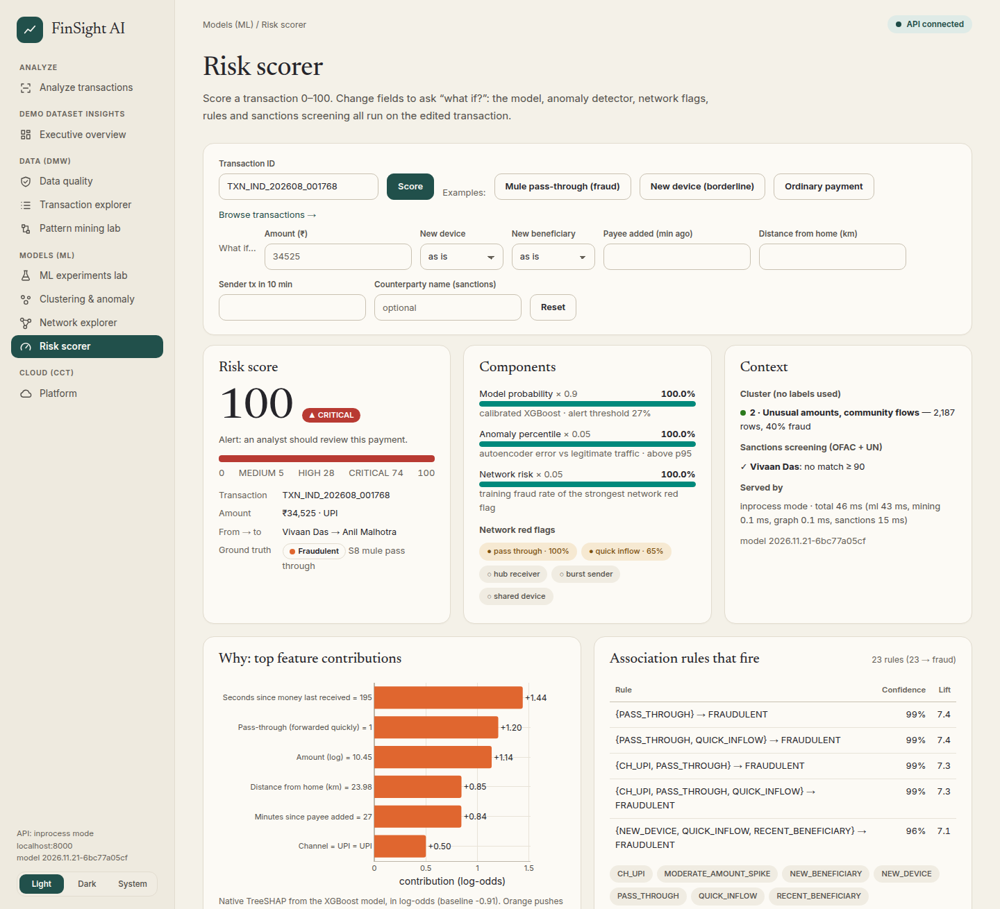

# FinSight AI

**Transaction risk intelligence for Indian digital payments (UPI · NEFT · RTGS): data mining, machine learning and a cloud-deployed web app.**

One project, submitted to three courses: **Data Mining & Wrangling (DMW)**, **Machine Learning (ML)** and **Cloud Computing & Technology (CCT)**.

| | |
|---|---|
| 🌐 **Live dashboard** | https://fin-sight-ai-bay.vercel.app |
| ⚙️ **Live API** (Swagger docs) | https://finsight-api-r2mw.onrender.com/docs |
| ▶️ **One-click demos** | [analyse the demo dataset](https://fin-sight-ai-bay.vercel.app/?run=sample) · [simulate a fraud ring + mule chain](https://fin-sight-ai-bay.vercel.app/?run=simulate&attacks=fraud_ring,mule_chain&size=12) · [camouflaged attack](https://fin-sight-ai-bay.vercel.app/?run=simulate&attacks=fraud_ring,shared_device&camouflage=1) |
| 📄 **Full report** | [`reports/FinSight_AI_Project_Report.pdf`](reports/FinSight_AI_Project_Report.pdf) |

> ⏱️ The API runs on Render's free tier, which sleeps after 15 minutes without traffic. The first visit shows **"Waking the backend…"** for up to about a minute.
> ⚠️ All India data is **synthetic**. Results describe the data generator and our documented changes, not real-world fraud.



## What it does
**Analyze transactions (home page).** Upload a CSV of payments, run the built-in demo dataset, or use the **attack simulator** (fraud ring, mule chain, burst, structuring, shared device, optionally camouflaged). For every transaction FinSight:
1. **Checks the data:** required columns, bad rows, unknown accounts, missing fields (defaults are reported).
2. **Builds the features:** behavioural features plus point-in-time network features (bursts, pass-through, fan-in, PageRank), computed over the bank's history plus your file.
3. **Scores it 0–100,** combining:
   - a calibrated XGBoost probability;
   - an autoencoder anomaly percentile;
   - network red flags;
   - mined association rules;
   - OFAC + UN sanctions screening.
4. **Explains the result:** tier (LOW / MEDIUM / HIGH / CRITICAL), top reasons (TreeSHAP), fired rules and the suspicious account structures it found.
5. **Checks accuracy** against labels, if the file has them. Labels never influence a score.

**Demo dataset insights** (the other pages) cover the rest of the project:
- **Data quality and leakage audit** of the raw data.
- **Transaction explorer** for browsing the 10,000 payments.
- **Pattern mining lab:** the association rules, and Apriori vs FP-Growth.
- **ML experiments lab:** classifier comparisons, tuning and SHAP explanations.
- **Clustering & anomaly detection.**
- **Network explorer** for following money between accounts.
- **What-if risk scorer:** change a payment and watch its score move.
- **Platform page:** live service health, latency and memory.

## Architecture
```
React SPA (Vite, TypeScript, Plotly)  ──HTTPS + CORS──▶  FastAPI gateway  ──▶  ml · mining · graph · sanctions
        Vercel (CDN, static)                              Render (Docker, free)   (in-process on Render; 5 containers with Docker Compose)
                                                               ▲
                              model bundle (versioned, sha256) ┘  GitHub Releases ◀── make pipeline → make bundle → make publish-artifacts
```
- **One codebase, two modes.** `FINSIGHT_SERVICE_MODE=inprocess` runs one container (the free Render deployment). `remote` runs 5 microservices: Docker Compose locally, or the `deploy/render-full.yaml` Blueprint. Both modes give identical scores, which the tests check.
- **12-factor configuration and security.**
  - All configuration comes from environment variables.
  - The API only accepts browser calls from origins on a CORS allow-list.
  - Internal services require an `X-Internal-Key` header.
  - Containers run as a non-root user.
  - Logs are structured JSON with request IDs, and `/metrics` reports latency.
- **Infrastructure as code and CI/CD:**
  - `render.yaml` and `frontend/vercel.json` describe the deployments.
  - GitHub Actions run the tests, build the dashboard, and build and smoke-test the Docker image at 512 MB.
  - Every push to `main` redeploys both sites.
- **Portability:** the same image runs unchanged in Docker Compose, in CI and on Render. A Google Cloud Run script (`deploy/cloudrun.sh`) and Kubernetes manifests (`deploy/k8s/`) are included but were not deployed, to avoid needing a billing card (D-038).

## Results
| Phase | Result |
|---|---|
| Audit (DMW) | Found label-leaking columns and "network" fraud scenarios with no network structure; fixed with a seeded, validated dataset v1.1 (v1.0 kept as a control) |
| Mining (DMW) | 49 productive rules (16 with network items). Apriori and FP-Growth find identical itemsets, but Apriori needs 1,317 MB vs 78.5 MB at the hardest setting |
| Supervised (ML) | Network features significantly help 5 of 6 classifiers on v1.1 and 0 of 6 on the control; SMOTE never helped |
| Production model (ML) | Tuned, isotonic-calibrated XGBoost: test **PR-AUC 0.885, F1 0.827** (precision 0.73, recall 0.94); stacking did not beat it; 0.43 MB |
| Unsupervised (ML) | 4 interpretable K-Means clusters (ARI 0.47); detectors trained only on legitimate data reach PR-AUC ≈ 0.55 and flag most BORDERLINE cases (unusual ≠ fraudulent) |
| Live analysis | Analysing the demo dataset reproduces every training feature exactly. Simulated attacks are caught 100% plain and 90–100% camouflaged (shared devices ~63%, the hardest case), with ~1.4% false alerts on normal payments |
| Services (CCT) | Local: warm `/score-transaction` p95 27 ms; 0 errors at 87 req/s in a load test; scaling the ML service to 3 replicas cut median latency under load by 38% |
| Live cloud (CCT) | Render free instance, measured from India: warm p50 105 ms / p95 194 ms (49 ms inside the API), 349 MB of 512 MB, cold start 58 s after the 15-minute sleep |

## Run it locally
```bash
uv sync --all-extras      # Python 3.12 env (CPU-only wheels); full steps in docs/SETUP.md
make test                 # 69 tests
make pipeline             # data → features → mining → supervised → unsupervised → final model (needs the dataset)
make bundle               # package the trained artifacts for serving
make serve                # API on http://localhost:8000/docs (single process)
make dashboard            # dashboard on http://localhost:5173 (run make serve too)
make up                   # or: 5 Docker microservices (gateway :8000 + ml / mining / graph / sanctions)
```
Score one transaction:
```bash
curl -X POST localhost:8000/score-transaction -H 'content-type: application/json' -d '{"transaction_id": "TXN_IND_202608_001768"}'
```
The dataset (`dataset/`) and trained artifacts (`artifacts/`) are not in Git. The deployed API downloads the published model bundle from this repo's **Releases**.

## Deploy your own copy
Render (API) first, then Vercel (dashboard), then add the Vercel address to Render's `FINSIGHT_CORS_ORIGINS`. Step by step: **[docs/DEPLOY.md](docs/DEPLOY.md)**.

## Repository map
```
src/finsight/   all logic: data/ graph/ mining/ ml/ sanctions/ scoring/ serving/ · pipeline.py
services/       entry points of the 5 FastAPI services
frontend/       React dashboard (Vercel)
docker/         one multi-stage Dockerfile + docker-compose.yml
deploy/         render-full.yaml, cloudrun.sh, k8s/, measure.py, publish_artifacts.sh
notebooks/      02 EDA · 03 mining · 04 supervised · 05 unsupervised · 06 tuning (display only)
reports/        result tables, figures and the project report PDF
tests/          pytest suite (data, features, mining, ML, serving, live analysis)
```

## Documentation
| Doc | Contents |
|---|---|
| [reports/FinSight_AI_Project_Report.pdf](reports/FinSight_AI_Project_Report.pdf) | Complete report: planning, every phase, results, syllabus mapping, slide outlines |
| [FinSight_AI_Project_Plan.md](FinSight_AI_Project_Plan.md) | Design spec: architecture, experiments, research questions |
| [docs/PROGRESS.md](docs/PROGRESS.md) | Phase tracker with acceptance criteria and session log |
| [docs/DECISIONS.md](docs/DECISIONS.md) | 39 design decisions with evidence |
| [docs/DATA.md](docs/DATA.md) | Data sources, lineage, column roles, leakage list |
| [docs/SETUP.md](docs/SETUP.md) | Installation and manual setup tasks |
| [docs/DEPLOY.md](docs/DEPLOY.md) | Render + Vercel deployment, step by step |
| [CLAUDE.md](CLAUDE.md) | Working rules for AI coding agents on this repo |
